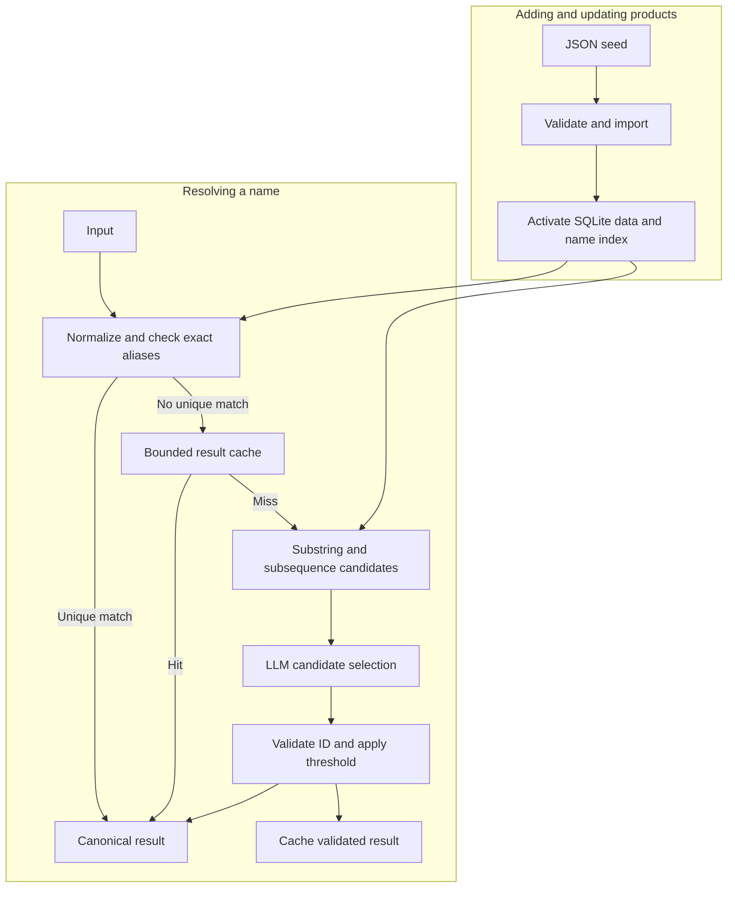
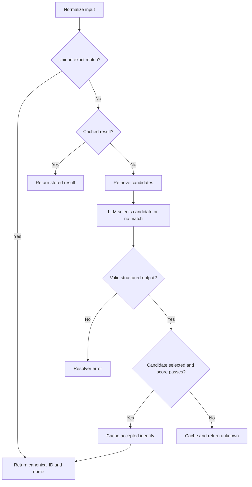

# Technology Entity Disambiguation

### Goal

Map a technology name to an existing product ID and canonical name, including unseen variants such as abbreviations. The dataset covers cloud services, EDR, SIEM, and SaaS products. Canonical names are `<vendor short name> <product>` with the vendor's own casing and punctuation ("AWS EKS", "Microsoft Sentinel"); a platform named after its vendor keeps that name ("Amazon Web Services"). Aliases share their product's stable ID.

### Resolution

1. **Normalize and look up.** Normalize capitalization and whitespace, preserving punctuation. Return a unique exact alias match; otherwise check the result cache.
2. **Retrieve candidates.** Match the full input against every product's full name and aliases using exact, substring, and subsequence matching. Rank exact matches before substrings before subsequences, deduplicate by product, and retain the top K. These rules only nominate candidates.
3. **Ask the LLM.** Supply the input and candidate IDs, names, vendors, aliases, and descriptions. Request an existing candidate ID or no match, plus a match score. Instruct the model to distinguish identical products from related products and reject insufficient evidence.
4. **Validate and decide.** Accept only a supplied ID whose score passes the configured threshold. Otherwise return `unknown`. Scores are model judgments, not probabilities; justify the threshold using labeled examples. Invalid output and API failures raise a resolver error.

### Ambiguity

Names shared by several products are not curated as aliases of either. "Sentinel" retrieves both Microsoft Sentinel and SentinelOne; the LLM selects one only above the threshold, otherwise the result is unknown. A vendor name used for its main product ("Splunk") is nominated by name matching and decided the same way. Platforms and their products stay separate: "Amazon Web Services" never absorbs "AWS EKS".

### Data and updates

SQLite stores products and aliases; shared names are multiple alias rows. Canonical names are aliases too. Validate JSON imports, preserve IDs, commit transactionally, and rebuild lookups before activation. Model decisions enter the cache, not the curated aliases. A data release bumps the pipeline version, which invalidates cached results and temporarily raises LLM calls.

### Consistency, scale, and cost

The PDF asks for determinism; Matan confirmed that small, measured LLM variation is acceptable, so we measure uncached agreement instead of claiming determinism. Fix the model version, prompt, candidate ordering, and generation settings.

The cache is bounded, expiring, and LRU, keyed by input and pipeline version. Exact matches and cache hits avoid model calls; other requests with candidates require one call with short candidate records.

Names are held in memory and matching scans all of them. Vendor nicknames absent from stored names ("MS sp") give weak, noisy matches. Benchmark at hundreds of thousands of products, measure shortlist recall, and estimate daily cost for millions of requests including zero cache hits; cache alone does not establish affordability.

### Evaluation

Choose K and the acceptance threshold on development data, then freeze them for separate tests. Report precision, recall, F1, candidate recall@K, false acceptance, p50/p95 latency, LLM-call rate, token cost, and uncached consistency. Cover unseen variants, near-collisions, hard negatives, idempotency, and unknown products. Unit tests use a fake LLM client and run offline; live evaluation is a separate command that needs an API key. Monitoring, scheduled evaluation, and human review remain documented stubs.

---

## Data schemas

### Knowledge base

| Table | Fields | Constraints |
|---|---|---|
| `entities` | `id TEXT`, `canonical_name TEXT`, `vendor TEXT`, `description TEXT` | `id` primary key; all fields required |
| `aliases` | `normalized_alias TEXT`, `entity_id TEXT` | Composite primary key; entity foreign key |

Enable foreign keys. Validate normalized canonical-name uniqueness during import, and reject an alias that equals another product's canonical name. The alias primary key supports exact lookup. Shared aliases produce multiple candidate IDs. `vendor` is used for canonical naming and shown to the LLM; matching does not use it.

**Seed JSON:** a list of `{id, canonical_name, vendor, description, aliases: [string]}` records. The importer normalizes aliases and inserts canonical names as aliases automatically.

### Candidate lookup

Build an in-memory map from normalized alias to entity IDs, plus a list of `{entity_id, name}` records from the alias table with spaces removed. Rebuild both after importing data. There are no embeddings or stored vectors.

For candidate matching, compare the input (spaces removed, other characters kept) with every record:

1. **Exact:** the input equals the name.
2. **Substring, either direction:** the input is inside the name ("sentinel" in "sentinelonesingularity"), or the name is inside the input ("aws" in "awscloudplatform").
3. **Subsequence:** the input's characters appear in order inside the name ("microsoftsp" in "microsoftsharepoint").

Rank exact, then substring, then subsequence. Within each group prefer fewer unmatched characters (length difference), then stable entity ID. Keep each entity's best match and retain the top K distinct entities. No match returns unknown without an LLM call.

All shared exact matches are included when they fit within K. If there are more than K exact candidates, return unknown rather than arbitrarily choosing a subset. Other truncated lists may miss the correct product; evaluation measures recall after truncation. Matching rules and ranking are fixed configuration, not model decisions.

### Result cache

| Field | Meaning |
|---|---|
| `key` | `(pipeline_version, normalized_input)` |
| `value` | Validated resolver result |
| `expires_at` | Time after which the entry is discarded |
| `last_accessed_at` | Used to evict least-recently-used entries |

Bound total cache memory, not just its lifetime. Do not cache API errors. The prototype can use an in-process cache; shared production caching is outside the implementation scope.

### Configuration

`pipeline_version` identifies the knowledge-base release, retrieval settings, LLM model, prompt, normalization rules, and acceptance policy.

Settings include `top_k`, `llm_score_threshold`, `cache_max_bytes`, and `cache_ttl_seconds`. Candidate matching never accepts a product by itself; only a unique exact alias or an accepted LLM selection resolves the input.

### LLM output and resolver response

The LLM returns:

```json
{
  "candidate_id": "product_001",
  "match_score": 0.93
}
```

The score must be between 0 and 1. `candidate_id` may be null for no match; a non-null ID must belong to the supplied candidate set. The number above illustrates the format, not a chosen threshold or a measured probability.

`resolve(name: str)` returns:

```json
{
  "status": "resolved",
  "canonical_id": "product_001",
  "canonical_name": "Vendor Product",
  "match_type": "llm",
  "score": 0.93,
  "pipeline_version": "release_001"
}
```

`score` is 1.0 for exact matches, the LLM `match_score` for LLM matches, and null for unknown. It fills the PDF's `confidence` role but is not calibrated. `status` is `resolved` or `unknown`. Unknown results have null canonical fields. `match_type` identifies `exact`, `llm`, or `none`; a cache hit preserves the original result. Empty input returns unknown without a model call. Provider failures and invalid responses raise a resolver error instead of claiming no product exists.

### Evaluation data

Development and test files contain `{input, expected_entity_id, case_type}` records. A null expected ID means unknown is appropriate. Keep test variants out of stored aliases and prompt examples. Log predictions, model scores, latency, token usage, cache hits, and pipeline version to calculate metrics and inspect errors. Threshold selection maximizes recall subject to a precision target fixed before tuning (proposed 0.95, because a false match is worse than an unknown); report sample counts and the precision/recall trade-off rather than treating a small sample as a guarantee.

---

## Architecture diagram



Candidate matching only nominates products. Failed LLM requests return errors and are not cached.

## Resolution flow diagram



Empty input returns unknown directly. An empty candidate set returns unknown, which is cached like other validated unknowns. Each request uses one pipeline version. The diagrams and schema reference accompany the main design; the LLM choice, numeric threshold, cost, and consistency results will be reported after implementation.
